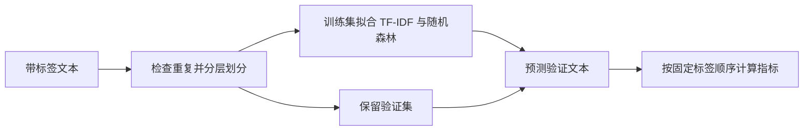

# 工程实现与设计取舍

这份索引笔记连接三个独立仓库中的实现路径：多模态实验的阶段衔接与解码、Agent 记忆的上下文组装与运行控制、文本分类的数据划分与服务批处理。例子用于解释代码行为；模型效果和真实服务性能需要独立实验。

## 1. FracLogGPT-Lite：让阶段衔接与预测恢复有明确语义

**问题。** 多阶段训练会产生多个 checkpoint；长时间推理可能中断，也可能重复写入。视觉对比解码则要求两条图像分支在同一文本前缀上比较下一 token 的分数。

**机制。**

- **阶段交接：** [`run_pipeline.py`](https://github.com/Darssal/FracLogGPT-Lite/blob/main/scripts/run_pipeline.py) 从配置读取阶段顺序，发现已有阶段产物，并将 `${checkpoint:sft}` 等占位符解析为下游输入。[`checkpoints.py`](https://github.com/Darssal/FracLogGPT-Lite/blob/main/src/fraclog/checkpoints.py) 通过 adapter、trainer state 或权重文件识别 checkpoint；在子目录候选中按修改时间选择最新项。命令预演允许保留尚未生成的占位符。
- **稳定样本键：** [`predictions.py`](https://github.com/Darssal/FracLogGPT-Lite/blob/main/src/fraclog/predictions.py) 优先使用 `id`，其次使用 `image` 或 `images[0]`。恢复时只处理未完成的键；结果去重时，同键保留最后一条。输出文件旁的 `.lock` 目录以排他创建方式阻止同时写入。
- **同步对比解码：** [`vcd.py`](https://github.com/Darssal/FracLogGPT-Lite/blob/main/src/fraclog/vcd.py) 将原图和扰动图的下一 token logits 按 `original + α × (original − perturbed)` 融合，只采样一次，再将同一 token 追加到两个分支。批处理路径把两个分支放在同一 batch 中维护缓存；HF `generate` 路径限制为确定性解码，以保持分支一致。

**小例子。** 已有结果含 `id:sample-a`，输入为 `sample-a`、`sample-b` 时，恢复模式只推理 `sample-b`。若两个分支对同一前缀分别给出不同的下一 token，融合后选出的 token 必须同时进入两边；让分支各自采样会使后续 logits 对应不同文本历史，失去直接对比的条件。

**设计取舍。** 以图像路径派生键依赖路径稳定；移动文件或同图多问时应提供显式且唯一的 `id`。目录锁处理并发互斥，没有实现进程崩溃后的自动租约回收。checkpoint 的“最新”指修改时间，不等于最佳验证分数或最大训练步数。缓存路径的单元测试验证张量与状态行为，实际模型、设备和 Transformers 版本的兼容性仍需集成验证。

**测试入口：** [阶段恢复](https://github.com/Darssal/FracLogGPT-Lite/blob/main/tests/test_run_pipeline.py) · [预测过滤、去重与互斥锁](https://github.com/Darssal/FracLogGPT-Lite/blob/main/tests/test_predictions.py) · [分支配对、字段对齐与缓存](https://github.com/Darssal/FracLogGPT-Lite/blob/main/tests/test_vcd.py) · [无 GPU 使用指南](https://github.com/Darssal/FracLogGPT-Lite/blob/main/docs/QUICKSTART.md)

## 2. MemLab：控制上下文注入，并记录运行是否有效

**问题。** 更多记忆不一定应该全部放进提示：候选可能重复、相关性不足，或与现有工具证据重叠。多个异步会话共享记忆管理器时，日志归属也不能依赖反复覆盖的全局回调。实验成功执行后，还需要判断其配置和记录是否满足比较条件。

**机制。**

- **上下文组装：** [`l0.py`](https://github.com/Darssal/MemLab/blob/main/memlab/memory_manager/l0.py) 先保留近期消息，再按检索分数排序候选；过滤低相关项，按键与版本去重，并用规范化文本前 512 个字符的哈希去除重复内容。选中记忆受注入预算约束，最终组装还会从前部裁剪消息。 [`manager.py`](https://github.com/Darssal/MemLab/blob/main/memlab/memory_manager/manager.py) 在已有直接工具证据时可绕过检索，并返回检索跳过原因、缓存命中和降级轨迹。
- **分层放置：** 同一管理器按重要度与对象大小选择 L0 近期上下文、L1 Redis、L2 Postgres / Qdrant 或 L3 对象存储。大对象可保存为正文加指针；异步写入队列提供批处理与背压策略。服务失败会进入降级记录，后台写入失败会向调用方暴露。
- **并发归属：** [`session_logging.py`](https://github.com/Darssal/MemLab/blob/main/memlab/session_logging.py) 安装共享操作 logger，从 `ContextVar` 读取当前 agent。会话 worker 设置上下文并在 `finally` 中恢复；A、B 会话交错执行时，各自的操作仍读取各自上下文。初始化和独立后台批次没有唯一会话归属时，字段可以为空。
- **运行有效性：** [`control_plane.py`](https://github.com/Darssal/MemLab/blob/main/memlab/pipeline/control_plane.py) 区分 accepted、invalid 和 diagnostic 等状态。新格式运行只有在已接受、汇总链有效、非诊断且未被替代时才进入正式报告；旧格式保留环境、复现和真实模型标志的兼容检查。失效运行记录异常、确定最早回滚阶段并生成重跑计划。[`summary_builder.py`](https://github.com/Darssal/MemLab/blob/main/memlab/metrics/summary_builder.py) 据此排除不合格运行。

**小例子。** 近期消息已经包含所需工具证据时，策略可以直接组装上下文，并记录 `direct_tool_evidence_present`；无需为了“使用记忆”再次检索。另一条运行即使生成了答案，若 manifest 被标记为 diagnostic，也不会成为正式对比表中的有效样本。

**设计取舍。** token 数按 `ceil(len(text) / 4)` 估算，属于启发式预算；它不是模型 tokenizer 的精确计数，单条过长的最终用户消息也不会被该裁剪循环删除。文本去重只比较规范化后的前缀，并非语义去重。默认 `hash_embedding` 用于确定性实验，不等同于经过训练的语义嵌入模型。`ContextVar` 解决异步调用上下文的日志归属，没有使跨服务写入成为事务，也不会为所有后台工作自动补上会话身份。有效性门禁约束报告输入，不能替代实验设计与人工判断。

**测试入口：** [检索绕过策略](https://github.com/Darssal/MemLab/blob/main/tests/test_memory_manager_policy.py) · [L3 指针化与降级轨迹](https://github.com/Darssal/MemLab/blob/main/tests/test_system_rebaseline.py) · [交错会话日志归属](https://github.com/Darssal/MemLab/blob/main/tests/test_stub_event_attribution.py) · [失效运行与回滚](https://github.com/Darssal/MemLab/blob/main/tests/test_control_plane.py) · [汇总排除与作用域](https://github.com/Darssal/MemLab/blob/main/tests/test_branch_audit.py) · [指标分母](https://github.com/Darssal/MemLab/blob/main/tests/test_metrics_denominator.py)

## 3. 招聘文本分类：隔离训练信息，明确批处理失败

**问题。** 在划分数据前拟合 TF-IDF 会把验证文本带入词表；分类器的内部类别顺序也可能与输出约定不同。批量调用外部服务时，超时、非法响应和认证失败需要终止语义，并发完成顺序不能改变记录与预测的对应关系。

**机制。**

- **先 split，后 fit：** [`data.py`](https://github.com/Darssal/Recruitment-Text-Classification/blob/main/src/job_text_classification/data.py) 检查标签，拒绝去空白、大小写规范化后相同的文本，再用固定种子按类别划分。 [`cli.py`](https://github.com/Darssal/Recruitment-Text-Classification/blob/main/src/job_text_classification/cli.py) 只把训练子集交给 `fit`；验证文本仅经过已拟合流水线的 `predict`。字符二至四元组 TF-IDF 与随机森林封装在 scikit-learn `Pipeline` 中。
- **按 `classes_` 对齐概率：** [`baseline.py`](https://github.com/Darssal/Recruitment-Text-Classification/blob/main/src/job_text_classification/baseline.py) 将 `predict_proba` 的每列先映射到分类器的真实类别，再按固定公共标签顺序输出。未参与训练的类别填入 `0.0`；指标计算还检查输入记录与预测的 ID 顺序一致。
- **有界 HTTP 调用：** [`http_adapter.py`](https://github.com/Darssal/Recruitment-Text-Classification/blob/main/src/job_text_classification/http_adapter.py) 为请求配置 timeout 和最大 attempts，失败后有限退避；除 429 外的 4xx 直接结束。响应大小和标签范围受检查。`ThreadPoolExecutor.map` 保留输入顺序，每条失败记录也会返回状态；CLI 写出结果后在有失败时返回退出码 2。输出保留记录 ID、标签、状态和概率，不写入输入原文、服务回复正文或凭据。

**小例子。** 分类器内部顺序为 `[人工智能, 环保]`，返回概率 `[0.2, 0.8]` 时，公开结果仍按 `[环保, 人工智能, 否]` 输出 `{环保: 0.8, 人工智能: 0.2, 否: 0.0}`。并发处理中第一条较慢、第二条先完成，最终结果仍以第一条、第二条排列；认证失败不会用完全部重试次数。

**设计取舍。** 拒绝规范化重复文本是明确的划分约束，没有解决语义近重复、同公司岗位泄漏或时间漂移；正式研究还需要独立测试方案。固定标签映射使接口稳定，不代表三类预测已经校准。保序意味着慢请求会影响后续结果交付；当前实现收集全部结果，不提供流式完成通知。timeout 约束请求等待，不是整个任务的严格总时限。该 HTTP 适配器遵循 `message / mode / textResponse` 协议，不包含知识库、索引或检索链路。

**测试入口：** [`test_regressions.py`](https://github.com/Darssal/Recruitment-Text-Classification/blob/main/tests/test_regressions.py) 覆盖训练词表隔离、固定种子与重复文本、概率列映射、记录对齐、模型保存加载、超时与非法响应、401 快速失败、并发保序及输出不含原文。运行方法见[项目 README](https://github.com/Darssal/Recruitment-Text-Classification/blob/main/README.md)。

## 维护入口

源码、测试和各项目的最新说明分别在 [FracLogGPT-Lite](https://github.com/Darssal/FracLogGPT-Lite)、[MemLab](https://github.com/Darssal/MemLab) 与 [Recruitment Text Classification](https://github.com/Darssal/Recruitment-Text-Classification) 维护。本页保留跨项目设计阅读路径；不承载可安装项目。JSP 学习原型及 CodePen 来源见 [JSP UI Prototype](https://github.com/Darssal/JSP-UI-Prototype)。
